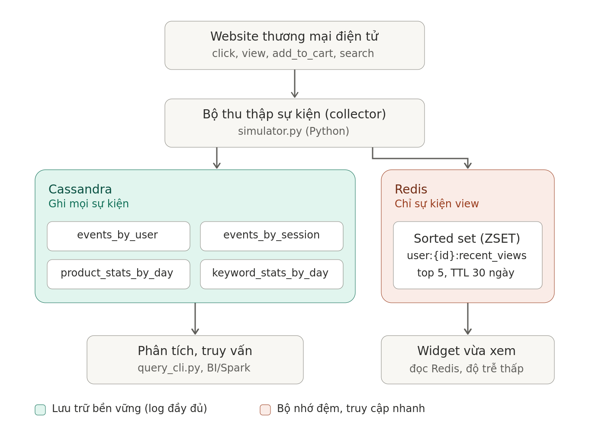
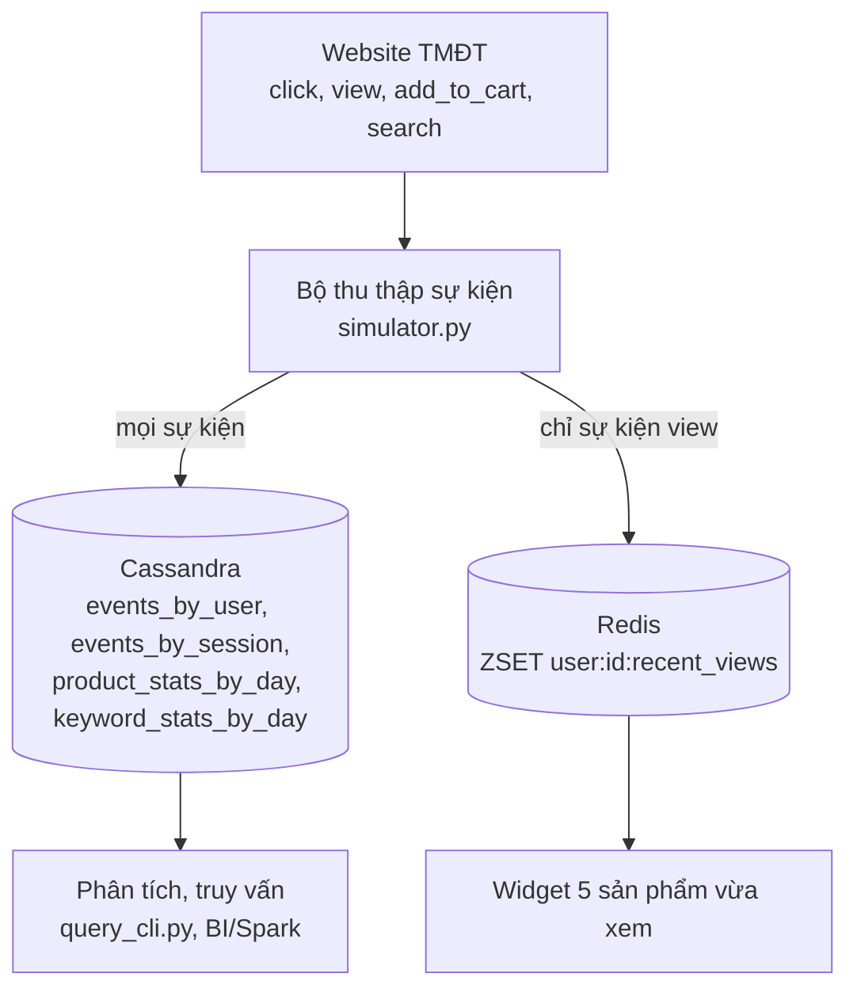

# Thiết kế hệ thống lưu vết hành vi người dùng trên website TMĐT

## 1. Bài toán

| Mục | Nội dung |
|---|---|
| Nhiệm vụ | Theo dõi Clickstream để phân tích |
| Lưu trữ | Toàn bộ log hành vi người dùng (click, xem, thêm vào giỏ, tìm kiếm) theo thời gian, phục vụ phân tích sau này |
| Yêu cầu riêng | Dùng Redis lưu 5 sản phẩm khách hàng vừa xem gần nhất |
| CSDL | Cassandra, Redis |

Đặc điểm dữ liệu: ghi rất nhiều, chỉ thêm mới (append-only), gắn với thời gian, ít khi sửa. Đây là mô hình phù hợp với Cassandra (ghi nhanh, mở rộng ngang). Redis phù hợp cho dữ liệu nhỏ, truy cập tức thời.

## 2. Kiến trúc





Luồng ghi: website gửi sự kiện tới bộ thu thập; bộ thu thập ghi mọi sự kiện vào Cassandra, riêng sự kiện `view` được ghi thêm vào Redis.
Luồng đọc: giao diện website đọc Redis để hiển thị "sản phẩm vừa xem" (độ trễ thấp); công cụ phân tích đọc Cassandra.

## 3. Các loại sự kiện

| event_type | Ý nghĩa | Trường liên quan |
|---|---|---|
| `search` | Tìm kiếm từ khóa | `search_keyword` |
| `click` | Click vào thẻ sản phẩm trong danh sách | `product_id`, `page_url` (trang danh sách) |
| `view` | Mở trang chi tiết sản phẩm | `product_id` |
| `add_to_cart` | Thêm vào giỏ hàng | `product_id`, `quantity` |

## 4. Phân tích truy vấn (Cassandra thiết kế theo truy vấn)

| # | Truy vấn nghiệp vụ | Nơi lưu |
|---|---|---|
| Q0 | 5 sản phẩm user vừa xem gần nhất | Redis ZSET |
| Q1 | Lịch sử hành vi của một user, mới nhất trước | `events_by_user` |
| Q2 | Hành trình click trong một phiên | `events_by_session` |
| Q3 | Số view/click/giỏ hàng của sản phẩm theo ngày | `product_stats_by_day` |
| Q4 | Từ khóa tìm kiếm phổ biến theo ngày | `keyword_stats_by_day` |

Cassandra không có JOIN và chỉ truy vấn hiệu quả theo khóa phân vùng, nên mỗi truy vấn có một bảng riêng và dữ liệu được ghi trùng (denormalization).

## 5. Thiết kế Cassandra (keyspace `ecommerce_tracking`)

### 5.1 `events_by_user`: log theo người dùng

| Cột | Kiểu | Vai trò |
|---|---|---|
| `user_id` | text | Partition key |
| `event_date` | date | Partition key (ngày theo giờ VN) |
| `event_time` | timestamp | Clustering, giảm dần |
| `event_id` | uuid | Clustering, đảm bảo duy nhất |
| `session_id`, `event_type`, `product_id`, `category`, `search_keyword`, `quantity`, `page_url`, `device` | | Thuộc tính sự kiện |

`PRIMARY KEY ((user_id, event_date), event_time, event_id)` với `CLUSTERING ORDER BY (event_time DESC, event_id ASC)`.

Lý do:
- Partition theo `(user_id, event_date)` để một partition không phình vô hạn khi user hoạt động lâu dài, và dữ liệu một user trong một ngày nằm trên cùng một node.
- Clustering `event_time DESC` giúp đọc sự kiện mới nhất trước mà không cần `ORDER BY`.
- `event_id` tránh hai sự kiện trùng mili-giây ghi đè nhau.

### 5.2 `events_by_session`: hành trình một phiên

`PRIMARY KEY ((session_id), event_time, event_id)` với `event_time ASC`. Một phiên chỉ có vài chục sự kiện nên partition luôn nhỏ. Cột giống `events_by_user` (thêm `user_id` làm cột thường).

### 5.3 `product_stats_by_day`: thống kê sản phẩm (counter)

`PRIMARY KEY ((event_date), product_id, event_type)`, cột `cnt counter`. Mỗi sự kiện có sản phẩm tăng `cnt` tương ứng, cho phép trả lời Q3 ngay mà không cần quét log.

### 5.4 `keyword_stats_by_day`: thống kê từ khóa (counter)

`PRIMARY KEY ((event_date), search_keyword)`, cột `cnt counter`.

### 5.5 Các quyết định kỹ thuật

| Vấn đề | Cách xử lý |
|---|---|
| Hai bảng log phải nhất quán | Chế độ realtime ghi bằng LOGGED BATCH |
| Tốc độ ghi hàng triệu bản ghi | Chế độ bulk ghi bất đồng bộ (`execute_concurrent`), insert idempotent nên thử lại an toàn |
| Tombstone | Trường không có giá trị dùng `UNSET`, không ghi `NULL` |
| Counter chịu tải | Gộp cộng dồn theo lô trước khi ghi |
| Múi giờ | Timestamp lưu UTC; `event_date` tính theo giờ Việt Nam (UTC+7) |
| Replication | Demo: `SimpleStrategy`, RF = 1. Thực tế: `NetworkTopologyStrategy`, RF = 3 |

## 6. Thiết kế Redis

| Mục | Giá trị |
|---|---|
| Key | `user:{user_id}:recent_views` |
| Kiểu | Sorted Set (ZSET) |
| Member / Score | `product_id` / timestamp (ms) của lần xem gần nhất |
| TTL | 30 ngày |

Ghi (mỗi sự kiện `view`):

```
ZADD user:U0001:recent_views GT <ts_ms> P005
ZREMRANGEBYRANK user:U0001:recent_views 0 -6     # chỉ giữ 5 phần tử mới nhất
EXPIRE user:U0001:recent_views 2592000
```

Đọc: `ZREVRANGE user:U0001:recent_views 0 4 WITHSCORES`.

Vì sao dùng ZSET thay vì LIST:
- Xem lại cùng một sản phẩm chỉ cập nhật score, không bị trùng trong danh sách.
- Thứ tự theo timestamp thật, vẫn đúng khi dữ liệu đến trễ (nhờ `GT`).
- Mỗi user chỉ có tối đa 5 phần tử nên bộ nhớ rất nhỏ.

## 7. Quy mô dữ liệu giả lập

Mặc định: 1.000.000 sự kiện, 1000 người dùng, rải trong 7 ngày. Mỗi sự kiện tạo 2 hàng log (`events_by_user` và `events_by_session`), tổng 2.000.000 hàng log, cộng các bảng counter và 1000 key Redis.

## 8. Đánh giá và hướng mở rộng

- Ưu điểm: ghi nhanh, mở rộng ngang bằng cách thêm node, truy vấn theo khóa phản hồi nhanh; Redis cho độ trễ rất thấp.
- Hạn chế: chỉ truy vấn tốt theo các khóa đã thiết kế; thống kê tùy ý cần Spark hoặc kho dữ liệu riêng; bảng counter có nguy cơ hot partition khi traffic cực lớn (có thể chia thêm theo giờ hoặc shard).
- Mở rộng: thay simulator bằng API thu thập hoặc Kafka; dùng `TimeWindowCompactionStrategy` và TTL cho bảng log; Spark phân tích phễu chuyển đổi click, view, giỏ hàng.
